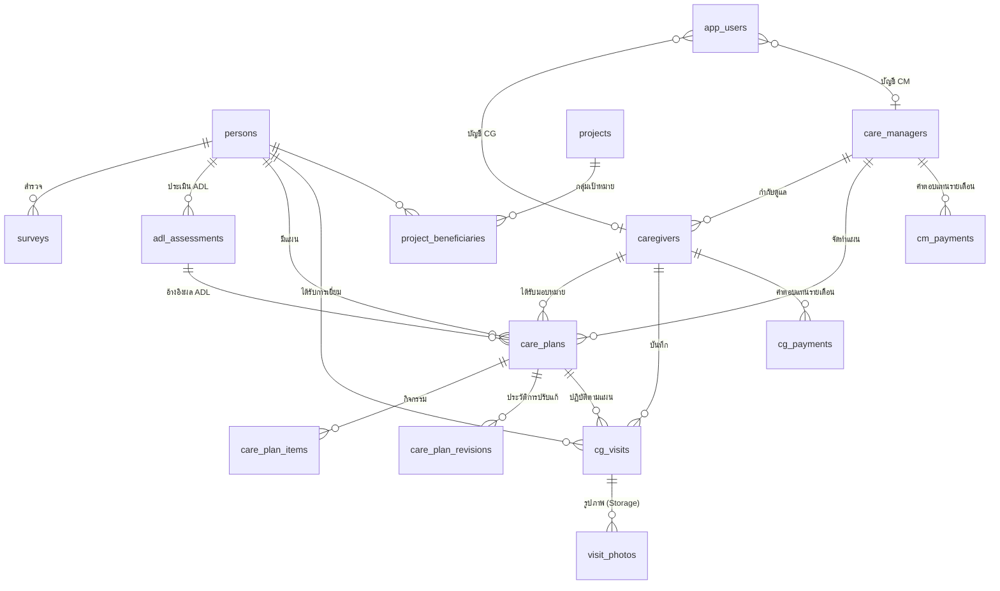

# Data model (Supabase)

| ตาราง | หน้าที่ |
|---|---|
| `persons` | ทะเบียนประชากร (เลขบัตร unique ใช้ upsert ตอนนำเข้า) |
| `surveys` | ผลสำรวจรายบุคคล/ครัวเรือน |
| `adl_assessments` | ผล Barthel ADL 10 ข้อ + คะแนนรวม + ระดับ + กลุ่ม 1-4 |
| `v_latest_adl` | view ผลประเมินล่าสุดของแต่ละคน (security_invoker) |
| `care_plans` / `care_plan_items` | แผนการดูแล + กิจกรรม (ครั้ง/เดือน × บาท/ครั้ง) |
| `care_plan_revisions` | snapshot JSON ของแผนก่อนการปรับแก้แต่ละครั้ง + เหตุผล |
| `cg_visits` / `visit_photos` | บันทึกการเยี่ยม (กิจกรรม JSON, สัญญาณชีพ JSON, GPS) + path รูปใน bucket `visit-photos` |
| `cg_payments` / `cm_payments` | ค่าตอบแทนรายงวด `YYYY-MM` (unique ต่อคนต่องวด) สถานะ draft → approved → paid |
| `projects` / `project_beneficiaries` | โครงการและรายชื่อกลุ่มเป้าหมาย |
| `settings` | `org`, `rates`, `adl` (JSON) |
| `app_users` / `audit_logs` | ผู้ใช้และบันทึกการใช้งาน |
| `dashboard_summary(p_month)` | RPC สรุปตัวเลข Dashboard ในคำสั่งเดียว |
